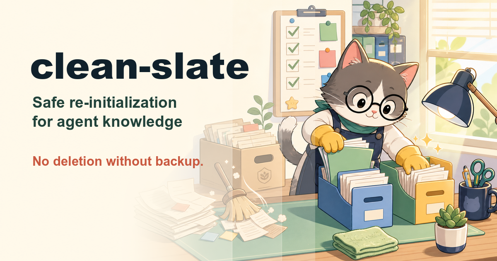

# clean-slate

**Safe re-initialization of a project's agent knowledge — burn the rotten
docs, rebuild from the code and the user's intent.**

`clean-slate` is an [agent skill](https://vercel.com/docs/agent-resources/skills)
for the day your knowledge files stop helping: `CLAUDE.md` contradicts the
code, three generations of agents left conflicting notes, the roadmap
describes a project that no longer exists. Past that point, patching costs
more than rebuilding.

## What it does

```
/clean-slate .
```

1. **Inventory** — finds every agent-knowledge file (CLAUDE.md, AGENTS.md,
   cursor rules, architecture docs, roadmaps, old plans) and classifies each
   delete / keep / ask. Human docs (README, CHANGELOG, end-user docs), code,
   and anything a build/CI/docs-site config references are never in scope.
2. **Salvage** — mines the old files for load-bearing claims and tags each
   one: **verified** (fresh `file:line` citation — survives), **refuted**
   (becomes a "common wrong assumption" warning), or **unverifiable from
   code** (deploy quirks, house rules — carried to the interview or the
   roadmap's open questions, never silently dropped).
3. **Backup gate** ⛔ — presents the exact delete list and asks where to back
   it up (recommended: `docs/_archive/<date>/` + a git tag). The question is
   only asked when the invocation didn't already authorize the reset — but
   **nothing is ever deleted without a count-verified backup**: headless
   runs and pre-authorized invocations take the recommended backup
   automatically, and if it can't be verified, they stop instead of
   deleting.
4. **Clean** — backs up, count-verifies the backup against the delete list
   (a command, not a judgment call), deletes only the confirmed list.
5. **Fresh read** — inventories the codebase from source: structure, wiring,
   data flow, git trajectory. Old docs are gone and are not trusted from
   memory.
6. **Direction interview** — asks the user where the project should go: one
   question at a time, each with a recommended answer grounded in the code,
   five questions max.
7. **Rebuild** — writes a strong, thin, fully-cited knowledge set:
   `AGENTS.md` (under 150 lines), `docs/ARCHITECTURE.md`, `ROADMAP.md` —
   including one anti-rot rule aimed at whatever made the old docs rot,
   so the reset doesn't just reset the clock.
8. **Report** — deleted / backed up / salvaged / dropped-as-false / created.

Progress lives in `.clean-slate/state.md`, so an interrupted run resumes
where it left off instead of restarting — and never re-asks a gate the
user already answered.

The philosophy is shared with the [deep-plan](https://github.com/silkyland/deep-plan)
skill family: **no claim without evidence** — and additionally: **no deletion
without a confirmed backup decision.** A thin true document beats a thick
maybe-true one.

## Install

```bash
npx skills add silkyland/clean-slate
```

Or copy this directory into your agent's skills folder
(e.g. `~/.claude/skills/clean-slate/`).

## Structure

```
clean-slate/
├── SKILL.md                              # 8-step workflow + safety rules + evidence tags
├── references/
│   ├── knowledge-file-patterns.md        # What's in scope, what's untouchable, CI-reference gate
│   ├── state-file.md                     # .clean-slate/state.md — resume an interrupted run
│   ├── interview-guide.md                # The direction interview question bank
│   └── rebuild-templates.md              # AGENTS.md / ARCHITECTURE.md / ROADMAP.md structures
└── evals/
    ├── scenarios.md                      # 3 manual eval scenarios (query + expected behavior)
    └── fixtures/                         # Rotten-doc repos each scenario runs the skill against
```

Follows the [Vercel skills](https://github.com/vercel-labs/skills) single-skill
layout and [Anthropic's skill authoring best practices](https://platform.claude.com/docs/en/agents-and-tools/agent-skills/best-practices).

## The skill family

| Skill | Moment |
|-------|--------|
| [know-my-repo](https://github.com/silkyland/know-my-repo) | Day one: onboard onto a repo with zero knowledge |
| [deep-plan](https://github.com/silkyland/deep-plan) | Plan the next feature/refactor — evidence-gated, 8 phases |
| [deep-plan-ingest](https://github.com/silkyland/deep-plan) | Distill an implemented plan into living knowledge files |
| [scaffold-my-plan](https://github.com/silkyland/scaffold-my-plan) | Turn a plan's first milestone into a running first slice |
| **clean-slate** | Reset rotten knowledge files — backup-gated |
| [transform-my-repo](https://github.com/silkyland/transform-my-repo) | Change the architecture: migration feasibility + strategy |
| [reproduce-my-bug](https://github.com/silkyland/reproduce-my-bug) | Prove the bug before anyone fixes it |
| [audit-my-layout](https://github.com/silkyland/audit-my-layout) | Measure a live page's visual consistency, viewport by viewport |
| [ground-my-ui](https://github.com/silkyland/ground-my-ui) | Prove the UI's contracts before anyone redesigns |
| [ground-my-shopware](https://github.com/silkyland/ground-my-shopware) | Shopware 6 admin/storefront UI grounded in installed vendor source |
| [seed-ah](https://github.com/silkyland/seed-ah) | A world of ONE company that reads like it has been in use for a year |
| [love-my-love-my-docs](https://github.com/silkyland/love-my-love-my-docs) | A user manual that regenerates itself |

Shared law: **no claim without evidence** — every skill in the family is
gated on citations, verification, and honest degraded modes.

## License

MIT
